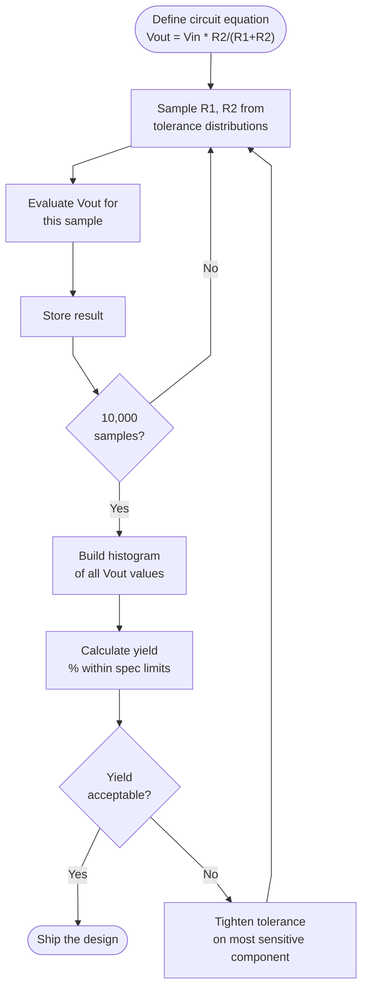

import ModelingSimulationComments from '../../../../components/modeling-and-simulation/ModelingSimulationComments.astro';
import TawkWidget from '../../../../components/TawkWidget.astro';
import UniversalContentContributors from '../../../../components/UniversalContentContributors.astro';
import InArticleAd from '../../../../components/InArticleAd.astro';
import Copyright from '../../../../components/Copyright.astro';
import BionicText from '../../../../components/BionicText.astro';
import TailwindWrapper from '../../../../components/TailwindWrapper.jsx';
import { Tabs, TabItem } from '@astrojs/starlight/components';
import { Card, CardGrid, Badge, Steps, LinkButton, FileTree } from '@astrojs/starlight/components';

<UniversalContentContributors 
  contributors={frontmatter.contributors}
/>


You design a voltage divider for 3.3 V. The calculation is correct, and the average of the boards you build is 3.3 V. Yet some boards are outside the limits and are scrapped, because every resistor is a little different from its nominal value. The same happens with the life of a pump or the cost of a project: the average looks fine, and the cases far from the average do the damage. The questions that matter are how often the result is outside the limit, and how bad it then is. Monte Carlo simulation answers them. It calculates the result thousands of times, each time with input values drawn at random from the range that each input can really have, and it counts the outcomes. #MonteCarlo #ToleranceAnalysis #EngineeringDesign

## The Monte Carlo Idea

<Card title="Why Monte Carlo Works" icon="star">
When uncertain inputs are multiplied and divided, an exact formula for the spread of the output is hard to find, so Monte Carlo counts instead, as you would roll two dice many times to learn how often a seven comes up. In each trial, every input gets a random value from its distribution, which is the description of the values it can take and how likely each one is. The output is calculated and stored. After thousands of trials, the histogram of the outputs shows how often each result happens. For distributions, see [Applied Mathematics: Probability, Statistics, and Noise](/education/applied-mathematics/probability-statistics-noise/). The result is only as good as the distributions you give it: the method cannot know that a spread was guessed.
</Card>



### When to Use Monte Carlo

Monte Carlo is the right tool when:

- The uncertain inputs are multiplied, divided or passed through a curve, not only added
- There are too many uncertain inputs for a calculation by hand
- You need the whole spread of the output, not only its mean
- The question is "what percentage of units will pass?" or "how often is the limit passed?"

It is not needed when:

- The output is a plain sum of inputs with bell-shaped (Gaussian) spreads. The output is then bell-shaped too, and its mean and variance can be calculated directly.
- You need only the worst-case limits. Use a minimum and maximum analysis.

## Project: Tolerance Stackup Analyzer

<InArticleAd />


<Card title="What You Will Build" icon="rocket">
A Monte Carlo tolerance analyzer for a voltage divider. A stackup is the way the tolerances of several parts add up in one result. The program runs 10,000 trials for each resistor tolerance (1%, 2%, 5%, 10%), plots the histograms of the output voltage, and calculates the yield: the percentage of boards inside the specification. A second example analyzes a shaft, a bearing and a housing.
</Card>

### Complete Runnable Code

```python
import numpy as np
import matplotlib.pyplot as plt

# ============================================================
# Monte Carlo Tolerance Stackup Analyzer
# ============================================================
# Analyzes how component tolerances affect system performance
# and predicts manufacturing yield.

np.random.seed(42)

N_TRIALS = 10000  # Number of Monte Carlo trials

# ============================================================
# Example 1: Voltage Divider Tolerance Analysis
# ============================================================
# Circuit: Vin ---[R1]---+---[R2]--- GND
#                        |
#                       Vout
#
# Vout = Vin * R2 / (R1 + R2)
#
# Nominal design: Vin = 5.0V, R1 = 10k, R2 = 20k
# Target Vout = 5.0 * 20k / (10k + 20k) = 3.333 V
# Specification: 3.3 V +/- 0.1 V (3.2 to 3.4 V)

Vin_nominal = 5.0
R1_nominal = 10e3   # 10 kohm
R2_nominal = 20e3   # 20 kohm

Vout_target = Vin_nominal * R2_nominal / (R1_nominal + R2_nominal)
Vout_spec_low = 3.2
Vout_spec_high = 3.4

print("=" * 65)
print("  Monte Carlo Tolerance Stackup Analysis")
print("=" * 65)
print(f"  Voltage divider: Vin={Vin_nominal}V, R1={R1_nominal/1e3:.0f}k, R2={R2_nominal/1e3:.0f}k")
print(f"  Nominal Vout:    {Vout_target:.4f} V")
print(f"  Specification:   {Vout_spec_low:.1f} V to {Vout_spec_high:.1f} V")
print(f"  Trials:          {N_TRIALS:,}")
print("-" * 65)

def voltage_divider_mc(R1_nom, R2_nom, Vin, tolerance_pct, n_trials):
    """
    Run Monte Carlo simulation for a voltage divider.
    Components are assumed to have uniform distribution within tolerance.
    (Uniform is conservative; real resistors often follow truncated Gaussian.)
    """
    tol = tolerance_pct / 100.0

    # Sample R1 and R2 from uniform distribution within tolerance
    R1_samples = R1_nom * (1 + tol * (2 * np.random.rand(n_trials) - 1))
    R2_samples = R2_nom * (1 + tol * (2 * np.random.rand(n_trials) - 1))

    # Compute Vout for each trial
    Vout_samples = Vin * R2_samples / (R1_samples + R2_samples)

    return Vout_samples

# Run for different tolerance grades
tolerances = [1, 2, 5, 10]
results = {}

for tol in tolerances:
    vout = voltage_divider_mc(R1_nominal, R2_nominal, Vin_nominal, tol, N_TRIALS)

    in_spec = np.sum((vout >= Vout_spec_low) & (vout <= Vout_spec_high))
    yield_pct = 100.0 * in_spec / N_TRIALS

    results[tol] = {
        'vout': vout,
        'mean': np.mean(vout),
        'std': np.std(vout),
        'min': np.min(vout),
        'max': np.max(vout),
        'yield': yield_pct,
    }

    print(f"  {tol:2d}% tolerance: mean={np.mean(vout):.4f}V, "
          f"std={np.std(vout):.4f}V, "
          f"range=[{np.min(vout):.3f}, {np.max(vout):.3f}]V, "
          f"yield={yield_pct:.1f}%")

# ============================================================
# Example 2: Mechanical Tolerance Stackup
# ============================================================
# Assembly: shaft inserted into bearing, bearing pressed into housing
#
#   |<-- Housing bore -->|
#   |  |<-- Bearing OD ->|  |
#   |  |  |<- Bearing ID ->|  |
#   |  |  |  |<- Shaft OD ->|  |
#
# Clearance = Bearing_ID - Shaft_OD
# Interference = Bearing_OD - Housing_bore (press fit)
#
# We need: clearance > 0.01 mm (shaft must spin freely)
#          interference > 0.005 mm (bearing must not fall out)

print("\n" + "=" * 65)
print("  Mechanical Tolerance Stackup: Shaft + Bearing + Housing")
print("=" * 65)

# Nominal dimensions (mm)
shaft_od_nom = 25.000
bearing_id_nom = 25.030   # 30 um nominal clearance
bearing_od_nom = 47.000
housing_bore_nom = 46.985  # 15 um nominal interference

# Manufacturing tolerances (mm), assumed Gaussian (3-sigma = tolerance)
shaft_tol = 0.010      # +/- 10 um
bearing_id_tol = 0.008  # +/- 8 um
bearing_od_tol = 0.008  # +/- 8 um
housing_tol = 0.012     # +/- 12 um

# Sample dimensions (Gaussian, 3-sigma = tolerance)
shaft_od = np.random.normal(shaft_od_nom, shaft_tol / 3, N_TRIALS)
bearing_id = np.random.normal(bearing_id_nom, bearing_id_tol / 3, N_TRIALS)
bearing_od = np.random.normal(bearing_od_nom, bearing_od_tol / 3, N_TRIALS)
housing_bore = np.random.normal(housing_bore_nom, housing_tol / 3, N_TRIALS)

# Compute clearance and interference
clearance = bearing_id - shaft_od       # must be > 0.01 mm
interference = bearing_od - housing_bore  # must be > 0.005 mm

clearance_ok = clearance > 0.01
interference_ok = interference > 0.005
both_ok = clearance_ok & interference_ok

mech_yield = 100.0 * np.sum(both_ok) / N_TRIALS

print(f"  Shaft OD:       {shaft_od_nom:.3f} +/- {shaft_tol:.3f} mm")
print(f"  Bearing ID:     {bearing_id_nom:.3f} +/- {bearing_id_tol:.3f} mm")
print(f"  Bearing OD:     {bearing_od_nom:.3f} +/- {bearing_od_tol:.3f} mm")
print(f"  Housing bore:   {housing_bore_nom:.3f} +/- {housing_tol:.3f} mm")
print(f"  ---")
print(f"  Clearance:      mean={np.mean(clearance):.4f} mm, "
      f"std={np.std(clearance):.4f} mm")
print(f"  Interference:   mean={np.mean(interference):.4f} mm, "
      f"std={np.std(interference):.4f} mm")
print(f"  Clearance OK:   {100*np.mean(clearance_ok):.1f}%")
print(f"  Interference OK:{100*np.mean(interference_ok):.1f}%")
print(f"  Both OK (yield):{mech_yield:.1f}%")
print("=" * 65)

# ============================================================
# Sensitivity analysis: which component matters most?
# ============================================================
print("\n--- Sensitivity Analysis (Voltage Divider, 5% tolerance) ---")

# Baseline
baseline_std = results[5]['std']

# Tighten both R1 and R2 to 1%
vout_tight_both = voltage_divider_mc(R1_nominal, R2_nominal, Vin_nominal, 1, N_TRIALS)

# Tighten R2 only to 1% (R1 stays at 5%)
R1_5pct = R1_nominal * (1 + 0.05 * (2 * np.random.rand(N_TRIALS) - 1))
R2_1pct = R2_nominal * (1 + 0.01 * (2 * np.random.rand(N_TRIALS) - 1))
vout_tight_r2_only = Vin_nominal * R2_1pct / (R1_5pct + R2_1pct)

# Tighten R1 only to 1% (R2 stays at 5%)
R1_1pct = R1_nominal * (1 + 0.01 * (2 * np.random.rand(N_TRIALS) - 1))
R2_5pct = R2_nominal * (1 + 0.05 * (2 * np.random.rand(N_TRIALS) - 1))
vout_tight_r1_only = Vin_nominal * R2_5pct / (R1_1pct + R2_5pct)

print(f"  Both at 5%:     std = {baseline_std:.5f} V")
print(f"  Both at 1%:     std = {np.std(vout_tight_both):.5f} V")
print(f"  R1=5%, R2=1%:   std = {np.std(vout_tight_r2_only):.5f} V")
print(f"  R1=1%, R2=5%:   std = {np.std(vout_tight_r1_only):.5f} V")
print(f"  -> Tightening either resistor alone gives the same improvement:")
print(f"     both have the same sensitivity magnitude, R1/(R1+R2).")

# ============================================================
# Plot results
# ============================================================
fig, axes = plt.subplots(2, 2, figsize=(14, 10))

# Plot 1: Voltage divider histograms for each tolerance
ax = axes[0, 0]
colors = ['green', 'blue', 'orange', 'red']
for tol, color in zip(tolerances, colors):
    r = results[tol]
    ax.hist(r['vout'], bins=80, alpha=0.5, color=color, density=True,
            label=f'{tol}% tol (yield={r["yield"]:.1f}%)')
ax.axvline(Vout_spec_low, color='black', linestyle='--', linewidth=2, label='Spec limits')
ax.axvline(Vout_spec_high, color='black', linestyle='--', linewidth=2)
ax.axvline(Vout_target, color='black', linestyle='-', linewidth=1, alpha=0.5)
ax.set_xlabel('Output Voltage (V)')
ax.set_ylabel('Probability Density')
ax.set_title('Voltage Divider: Output Distribution by Tolerance Grade')
ax.legend(fontsize=8)
ax.grid(True, alpha=0.3)

# Plot 2: Yield vs tolerance
ax = axes[0, 1]
yields = [results[t]['yield'] for t in tolerances]
ax.bar([str(t) + '%' for t in tolerances], yields, color=colors, alpha=0.7,
       edgecolor='black')
ax.axhline(y=99.0, color='green', linestyle='--', alpha=0.7, label='99% target')
ax.axhline(y=95.0, color='orange', linestyle='--', alpha=0.7, label='95% target')
ax.set_xlabel('Component Tolerance')
ax.set_ylabel('Yield (%)')
ax.set_title('Manufacturing Yield vs Component Tolerance')
ax.legend()
ax.grid(True, alpha=0.3, axis='y')
for i, (tol, y) in enumerate(zip(tolerances, yields)):
    ax.text(i, y + 0.5, f'{y:.1f}%', ha='center', fontsize=10, fontweight='bold')

# Plot 3: Mechanical clearance histogram
ax = axes[1, 0]
ax.hist(clearance * 1000, bins=80, alpha=0.6, color='steelblue', density=True,
        label=f'Clearance (yield={100*np.mean(clearance_ok):.1f}%)')
ax.axvline(10, color='red', linestyle='--', linewidth=2, label='Min clearance (10 um)')
ax.axvline(0, color='black', linestyle='-', linewidth=1, alpha=0.5)
ax.set_xlabel('Clearance (um)')
ax.set_ylabel('Probability Density')
ax.set_title('Shaft-Bearing Clearance Distribution')
ax.legend(fontsize=9)
ax.grid(True, alpha=0.3)

# Plot 4: Mechanical interference histogram
ax = axes[1, 1]
ax.hist(interference * 1000, bins=80, alpha=0.6, color='coral', density=True,
        label=f'Interference (yield={100*np.mean(interference_ok):.1f}%)')
ax.axvline(5, color='red', linestyle='--', linewidth=2, label='Min interference (5 um)')
ax.axvline(0, color='black', linestyle='-', linewidth=1, alpha=0.5)
ax.set_xlabel('Interference (um)')
ax.set_ylabel('Probability Density')
ax.set_title('Bearing-Housing Interference Distribution')
ax.legend(fontsize=9)
ax.grid(True, alpha=0.3)

plt.tight_layout()
plt.savefig('monte_carlo_tolerance.png', dpi=150, bbox_inches='tight')
plt.show()
print("\nPlot saved: monte_carlo_tolerance.png")
```

### Reading the Results

<Steps>

1. **Histogram spread.** The mean output is 3.33 V for all four tolerances; only the spread changes. With 1% resistors the histogram is a narrow peak at the target. With 10% resistors it is wide, and a large part of it lies outside the limits.

2. **Yield numbers.** The yield is 100% with 1% and 2% resistors, 92.0% with 5% resistors and 66.7% with 10% resistors. This is the number for production planning: at a yield of 92% you must build 109 boards to ship 100.

3. **Sensitivity analysis.** Tightening one component at a time shows which one matters most. In a voltage divider both resistors have the same influence: a 1% change in $R_1$ and a 1% change in $R_2$ each move $V_{out}$ by the same fraction, $R_1/(R_1+R_2)$, in opposite directions. Tightening one of them reduces the spread from about 0.045 V to about 0.033 V, and tightening both gives about 0.009 V. For the yield, one is already enough here: with $R_1$ at 1% and $R_2$ at 5%, no combination leaves the limits. The decision depends on where the limits are, not on the spread alone.

4. **Mechanical stackup.** The nominal dimensions look safe, but the simulation finds that in 1.8% of assemblies the press fit is too loose and the bearing can come out of the housing. The clearance of the shaft is never too small.

</Steps>

## Monte Carlo vs Worst-Case Analysis

<InArticleAd />


Worst-case analysis assumes every component is simultaneously at its worst tolerance limit. For the voltage divider with 5% resistors:

- Worst-case high: $R_1$ at $-5\%$, $R_2$ at $+5\%$, giving maximum $V_{out} = 3.443\,\text{V}$
- Worst-case low: $R_1$ at $+5\%$, $R_2$ at $-5\%$, giving minimum $V_{out} = 3.220\,\text{V}$

The worst case tells you that a failure is possible, not how often, because all components are almost never at their limits together. Monte Carlo gives the "how often".

| Method | Output range (5% resistors) | Useful for |
|--------|----------------------------|------------|
| Worst-case | Widest possible range | Safety-critical bounds |
| RSS (root sum square) | Moderate range | Quick estimate if linear and Gaussian |
| Monte Carlo | Realistic distribution | Full picture, nonlinear systems, yield |

Where a failure can harm people (medical devices, aircraft), the approval usually asks for a worst-case analysis, and Monte Carlo is used to improve the design.

## Choosing Distributions

<InArticleAd />


The distribution you assume for each input decides the result. For the divider with 5% resistors, a uniform distribution (every value in the band equally likely) gives a yield of 92%. A Gaussian distribution (bell-shaped, with three standard deviations at 5%) gives 99.5%. The parts and the program are the same.

So state the distribution of every input next to the result, and say where it comes from: a datasheet, a measured sample of parts, or a cautious guess. A Monte Carlo result without its assumptions cannot be checked. Typical choices:

| Component | Typical Distribution | Notes |
|-----------|---------------------|-------|
| Resistors (tight tolerance) | Gaussian, cut off at the tolerance | Tested at the factory, rejects removed |
| Resistors (wide tolerance) | Uniform | What is left after the tight parts are sold |
| Capacitors | Gaussian, cut off at the tolerance | Temperature and age also shift the value |
| Machined dimensions | Gaussian | Many small independent errors add up |
| PCB trace width | Gaussian | Etching errors are the same in both directions |

The uniform distribution is the cautious choice when you have no data. If you have measurements from production, use the distribution they show.

## Number of Trials

<InArticleAd />


A Monte Carlo result is itself uncertain: another set of random numbers gives a slightly different answer. For a yield $p$ (as a fraction) from $N$ trials, the standard error is $\sqrt{p(1-p)/N}$. A yield of 92% from 10,000 trials is uncertain by about 0.3%, so report 92% and not 92.03%. A quick check is to run again with another seed and see how far the answer moves. The error falls as $1/\sqrt{N}$:

| Trials | Standard error of mean | Standard error of 99th percentile |
|--------|----------------------|-----------------------------------|
| 1,000 | Moderate | Poor |
| 10,000 | Good for means | Acceptable |
| 100,000 | Excellent | Good |
| 1,000,000 | Overkill for means | Excellent for tail estimates |

A yield close to 100% needs more trials. To estimate 99.9% yield with confidence, run at least 100,000 trials, so that there are enough failures (about 100) to estimate the failure rate.

## Exercises

<InArticleAd />


1. **Temperature drift.** Add a temperature coefficient to the resistors: each resistor drifts by $\pm 100\,\text{ppm}/^\circ\text{C}$. Run the Monte Carlo with temperature uniformly distributed from $0\,^\circ\text{C}$ to $70\,^\circ\text{C}$. How does yield change?

2. **Voltage regulator.** Model a linear voltage regulator with input voltage (5.0V, 5% tolerance), reference voltage (1.25V, 1% tolerance), and two feedback resistors (both 1% tolerance). The output is $V_{out} = V_{ref} \cdot (1 + R_1/R_2)$. What yield do you get for $3.3\,\text{V} \pm 2\%$?

3. **Mechanical press fit.** In the shaft-bearing example, tighten the housing bore tolerance from $12\,\mu\text{m}$ to $6\,\mu\text{m}$. How much does yield improve? What if you tighten the shaft instead?

4. **Correlated variations.** What if $R_1$ and $R_2$ come from the same reel and their errors are correlated (both tend to be high or both tend to be low)? Modify the simulation to use correlated random samples and observe how the output distribution changes.

5. **Cost optimization.** Assign costs to each tolerance grade (1% costs 3x more than 5%). Find the combination of $R_1$ and $R_2$ tolerances that achieves 99% yield at minimum total cost.

## References

<InArticleAd />


- Gilks, W. R. et al. (1995). *Markov Chain Monte Carlo in Practice*. Chapman and Hall. The statistical foundations.
- Bruns, M. (2006). *Tolerance Analysis and Optimization of Mechanical Assemblies*. PhD Thesis, University of Erlangen. Good coverage of mechanical tolerance stackup methods.
- Hayter, A. J. (2012). *Probability and Statistics for Engineers and Scientists*. Cengage. Covers the statistical fundamentals behind Monte Carlo.
- Analog Devices Application Note AN-1208. *Component Tolerances and their Effect on Filter Performance*. Practical tolerance analysis for analog circuits.


<InArticleAd />
<ModelingSimulationComments />
<TawkWidget />
<Copyright />
