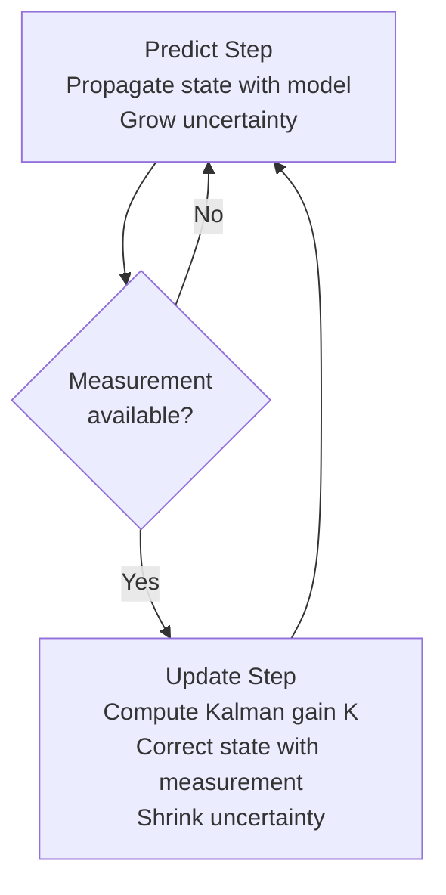

import ModelingSimulationComments from '../../../../components/modeling-and-simulation/ModelingSimulationComments.astro';
import TawkWidget from '../../../../components/TawkWidget.astro';
import UniversalContentContributors from '../../../../components/UniversalContentContributors.astro';
import InArticleAd from '../../../../components/InArticleAd.astro';
import Copyright from '../../../../components/Copyright.astro';
import BionicText from '../../../../components/BionicText.astro';
import TailwindWrapper from '../../../../components/TailwindWrapper.jsx';
import { Tabs, TabItem } from '@astrojs/starlight/components';
import { Card, CardGrid, Badge, Steps, LinkButton, FileTree } from '@astrojs/starlight/components';

<UniversalContentContributors 
  contributors={frontmatter.contributors}
/>


A level sensor on a tank is disturbed by waves. A gyroscope gives an angle that slowly moves away from the truth. One sensor alone is often wrong in a way that no filter can repair. But two sensors are usually wrong in different ways: one is noisy and does not drift, the other is smooth and drifts. Sensor fusion combines them so that each covers the weakness of the other. In this lesson you build the two standard methods, a complementary filter and a Kalman filter, for an IMU (inertial measurement unit: an accelerometer and a gyroscope in one chip). You test them on simulated data, where the true angle is known. #SensorFusion #KalmanFilter #IMU

## The Problem with Single Sensors

<Card title="Why One Sensor Is Never Enough" icon="star">
An accelerometer can give the tilt angle from the direction of gravity, but it also measures every vibration and every push. A gyroscope measures cleanly how fast the angle changes. To get the angle you must add up its readings, and then every small error is added up too, so the result drifts without limit. The two errors are of different kinds. The accelerometer is wrong from moment to moment but right on average. The gyroscope is right from moment to moment but wrong in the long run. Fusion uses each sensor for what it does well.
</Card>

### Accelerometer Angle Estimation

When the sensor is still, or moves at constant velocity, the only acceleration it measures is gravity. The direction of gravity across two axes of the sensor gives the tilt angle:

$$\theta_{accel} = \arctan\left(\frac{a_x}{a_z}\right)$$

Here $a_x$ and $a_z$ are the accelerations measured along two axes, in m/s², and $\theta_{accel}$ is the tilt in degrees. This works well on a desk. On a moving robot or a vibrating motor mount, every push is read as a change of tilt.

### Gyroscope Angle Estimation

The gyroscope gives the angular rate $\omega$ in degrees per second. To get the angle, add the rate times the time step $\Delta t$ (in seconds) to the previous angle:

$$\theta_{gyro}(t) = \theta_{gyro}(t - \Delta t) + \omega \cdot \Delta t$$

The result is smooth and fast, but every small error in $\omega$ is added again at each step. A steady error of only 0.2 degrees per second gives 12 degrees of error after one minute.

## Sensor Fusion Block Diagram

<InArticleAd />


Low-pass means "keep the slow part" and high-pass means "keep the fast part". Fusion takes the slow part of the angle from the accelerometer and the fast part from the gyroscope:

```text
  Accelerometer    ┌──────────────────┐
  noisy, no drift ►│ keep the slow    │──┐
                   │ part (low-pass)  │  │
                   └──────────────────┘  ├──► angle
  Gyroscope        ┌──────────────────┐  │    estimate
  smooth, drifts ─►│ keep the fast    │──┘
                   │ part (high-pass) │
                   └──────────────────┘
```

## The Complementary Filter

<InArticleAd />


The complementary filter is a weighted mix of two estimates. At each step it takes the previous angle, adds the turn measured by the gyroscope, and then pulls the result a little toward the accelerometer angle. One number, $\alpha$ (typically 0.95 to 0.98), sets how weak this pull is:

$$\theta[n] = \alpha \cdot (\theta[n-1] + \omega[n] \cdot \Delta t) + (1 - \alpha) \cdot \theta_{accel}[n]$$

Here $\theta[n]$ is the angle estimate at step $n$. With $\alpha = 0.98$, each step takes 98% from the gyroscope path and 2% from the accelerometer. The gyroscope gives the fast response, and the accelerometer slowly removes the drift. The filter needs one multiplication and one addition per sample, so it runs on any microcontroller.

The method is not only for motion sensors. A tank level known from a level sensor (noisy, no drift) and from the total of a flow meter (smooth, drifts) is combined in the same way.

### Choosing Alpha

The time constant $\tau$, in seconds, is the time the filter needs to remove most of an old error:

$$\tau = \frac{\alpha \cdot \Delta t}{1 - \alpha}$$

For $\alpha = 0.98$ and $\Delta t = 0.01$ s (100 Hz), $\tau = 0.49$ s. Changes faster than this come mostly from the gyroscope, and slower changes from the accelerometer. A higher $\alpha$ gives a smoother output but corrects drift more slowly. A lower $\alpha$ corrects drift faster but lets more accelerometer noise through.

## The Kalman Filter

<InArticleAd />


The Kalman filter makes the same kind of mix, but it calculates the weight itself, again at every step. It keeps two things: its best estimate, and a number that says how uncertain that estimate is. When its own prediction is uncertain it leans on the measurement, and when the measurement is noisy it leans on the prediction. Each cycle has two steps.



### Predict Step

In words: move the estimate forward in time with the gyroscope reading, and make its uncertainty larger, because a prediction is less certain than the estimate it started from.

$$\hat{\mathbf{x}}^- = \mathbf{A} \hat{\mathbf{x}} + \mathbf{B} u$$

$$\mathbf{P}^- = \mathbf{A} \mathbf{P} \mathbf{A}^T + \mathbf{Q}$$

The symbols:

- $\hat{\mathbf{x}}$ is the estimate of the state (the quantities to be found, here the angle and the gyroscope error). The hat means "estimate" and the minus sign means "before the measurement is used".
- $\mathbf{A}$ says how the state moves from one step to the next, and $\mathbf{B}$ says how the input $u$ (the gyroscope rate) changes it.
- $\mathbf{P}$ is the uncertainty of the estimate, held as variances.
- $\mathbf{Q}$ is the uncertainty that each prediction adds (the process noise).

### Update Step

In words: compare the measurement with the prediction, move the estimate toward the measurement by a fraction $\mathbf{K}$ of the difference, and make the uncertainty smaller.

$$\mathbf{K} = \mathbf{P}^- \mathbf{H}^T (\mathbf{H} \mathbf{P}^- \mathbf{H}^T + \mathbf{R})^{-1}$$

$$\hat{\mathbf{x}} = \hat{\mathbf{x}}^- + \mathbf{K}(z - \mathbf{H}\hat{\mathbf{x}}^-)$$

$$\mathbf{P} = (\mathbf{I} - \mathbf{K}\mathbf{H})\mathbf{P}^-$$

Here $z$ is the measurement (the accelerometer angle), $\mathbf{H}$ picks from the state the quantity that is measured, $\mathbf{R}$ is the variance of the measurement noise, and $\mathbf{I}$ is the identity matrix.

For a single quantity the gain $\mathbf{K}$, called the Kalman gain, is simply $K = P / (P + R)$. An uncertain prediction (large $P$) gives a gain near 1, and the filter follows the measurement. A noisy measurement (large $R$) gives a gain near 0, and the filter keeps its prediction. For the matrix algebra, see [Applied Mathematics: Linear Algebra, Vectors, and Matrices](/education/applied-mathematics/linear-algebra-vectors-matrices/).

### State Vector for IMU Fusion

For one axis of an IMU, the state holds two quantities:

$$\mathbf{x} = \begin{bmatrix} \theta \\ b \end{bmatrix}$$

where $\theta$ is the angle and $b$ is the gyroscope bias, the steady error of its rate in degrees per second. The filter estimates both and subtracts the bias from every gyroscope reading. The complementary filter cannot do this.

## Project: IMU Orientation Estimator

<InArticleAd />


<Card title="What You Will Build" icon="rocket">
A program that makes 60 seconds of simulated IMU data with a known true angle, applies a complementary filter and a Kalman filter, and prints the error of each sensor and each filter. The noise, the gyroscope drift and the bumps have the size found in low-cost MEMS sensors (small motion sensors made in silicon).
</Card>

### Complete Runnable Code

```python
import numpy as np
import matplotlib.pyplot as plt

# ============================================================
# IMU Orientation Estimator: Complementary + Kalman Filter
# ============================================================
# Simulates accelerometer and gyroscope data with realistic
# noise, then fuses them using two different algorithms.

np.random.seed(42)

# --- Simulation parameters ---
dt = 0.01              # 100 Hz sample rate
t_end = 60.0           # 60 seconds of data
t = np.arange(0, t_end, dt)
N = len(t)

# --- True angle trajectory ---
# Slow sinusoidal motion (like a robot arm or gimbal)
true_angle = 30.0 * np.sin(0.2 * t) + 10.0 * np.sin(0.05 * t)
true_rate = np.gradient(true_angle, dt)  # true angular rate (deg/s)

# --- Simulated accelerometer ---
# Good for static angle, but noisy and affected by vibrations
accel_noise_std = 3.0  # degrees
vibration_noise = 5.0 * np.sin(50 * t) * np.exp(-0.05 * t)  # decaying vibration
accel_angle = true_angle + accel_noise_std * np.random.randn(N) + vibration_noise

# Add occasional impulse disturbances (bumps)
bump_indices = np.random.choice(N, size=20, replace=False)
accel_angle[bump_indices] += np.random.uniform(-15, 15, size=20)

# --- Simulated gyroscope ---
# Smooth but drifts over time
gyro_noise_std = 0.3   # deg/s
gyro_bias_0 = 0.2      # deg/s constant bias at switch-on
gyro_bias_rate = 0.02  # deg/s per sqrt(s), random walk of the bias
gyro_bias = gyro_bias_0 + np.cumsum(gyro_bias_rate * np.sqrt(dt) * np.random.randn(N))
gyro_rate = true_rate + gyro_noise_std * np.random.randn(N) + gyro_bias

# --- Raw gyro integration (to show drift) ---
gyro_angle = np.zeros(N)
gyro_angle[0] = accel_angle[0]
for i in range(1, N):
    gyro_angle[i] = gyro_angle[i - 1] + gyro_rate[i] * dt

# ============================================================
# Complementary Filter
# ============================================================
def complementary_filter(accel_angle, gyro_rate, dt, alpha=0.98):
    """
    Fuse accelerometer angle and gyroscope rate.
    alpha: weight for gyroscope (0.95 to 0.99 typical).
    """
    n = len(accel_angle)
    angle = np.zeros(n)
    angle[0] = accel_angle[0]

    for i in range(1, n):
        # Gyro prediction + accel correction
        angle[i] = alpha * (angle[i - 1] + gyro_rate[i] * dt) \
                   + (1 - alpha) * accel_angle[i]

    return angle

# ============================================================
# Kalman Filter for IMU Fusion
# ============================================================
def kalman_filter_imu(accel_angle, gyro_rate, dt,
                      Q_angle=0.001, Q_bias=0.00001, R_measure=10.0):
    """
    2-state Kalman filter: estimates angle and gyro bias.

    State: x = [angle, bias]^T
    Prediction:  angle_new = angle + (gyro - bias) * dt
                 bias_new  = bias
    Measurement: z = accel_angle

    Q_angle:   process noise for angle state
    Q_bias:    process noise for bias state
    R_measure: measurement noise (accelerometer variance)
    """
    n = len(accel_angle)
    angle_est = np.zeros(n)
    bias_est = np.zeros(n)

    # Initial state
    angle_est[0] = accel_angle[0]
    bias_est[0] = 0.0

    # Error covariance matrix P (2x2)
    P = np.array([[1.0, 0.0],
                  [0.0, 1.0]])

    # Process noise covariance
    Q = np.array([[Q_angle, 0.0],
                  [0.0, Q_bias]])

    # Measurement matrix: we only measure angle
    H = np.array([[1.0, 0.0]])
    R = np.array([[R_measure]])

    for i in range(1, n):
        # --- Predict ---
        # State prediction
        rate = gyro_rate[i] - bias_est[i - 1]
        angle_pred = angle_est[i - 1] + rate * dt
        bias_pred = bias_est[i - 1]

        # Covariance prediction
        # A = [[1, -dt], [0, 1]]
        A = np.array([[1.0, -dt],
                      [0.0, 1.0]])
        P = A @ P @ A.T + Q

        # --- Update ---
        # Innovation (measurement residual)
        z = accel_angle[i]
        y = z - angle_pred  # H @ x_pred = angle_pred

        # Innovation covariance
        S = P[0, 0] + R_measure

        # Kalman gain (2x1)
        K = np.array([[P[0, 0] / S],
                      [P[1, 0] / S]])

        # State update
        angle_est[i] = angle_pred + K[0, 0] * y
        bias_est[i] = bias_pred + K[1, 0] * y

        # Covariance update
        I_KH = np.array([[1.0 - K[0, 0], 0.0],
                         [-K[1, 0], 1.0]])
        P = I_KH @ P

    return angle_est, bias_est

# ============================================================
# Run both filters
# ============================================================
comp_angle = complementary_filter(accel_angle, gyro_rate, dt, alpha=0.98)
kalman_angle, kalman_bias = kalman_filter_imu(
    accel_angle, gyro_rate, dt,
    Q_angle=0.001, Q_bias=0.00001, R_measure=10.0
)

# ============================================================
# Compute errors
# ============================================================
accel_rmse = np.sqrt(np.mean((accel_angle - true_angle) ** 2))
gyro_rmse = np.sqrt(np.mean((gyro_angle - true_angle) ** 2))
comp_rmse = np.sqrt(np.mean((comp_angle - true_angle) ** 2))
kalman_rmse = np.sqrt(np.mean((kalman_angle - true_angle) ** 2))

print("=" * 55)
print("  IMU Orientation Estimation: Error Comparison")
print("=" * 55)
print(f"  Raw Accelerometer  RMSE: {accel_rmse:8.3f} deg")
print(f"  Raw Gyro (integrated)  : {gyro_rmse:8.3f} deg")
print(f"  Complementary Filter   : {comp_rmse:8.3f} deg")
print(f"  Kalman Filter          : {kalman_rmse:8.3f} deg")
print("=" * 55)
print(f"\n  Complementary filter is {accel_rmse / comp_rmse:.1f}x better than raw accel")
print(f"  Kalman filter is {accel_rmse / kalman_rmse:.1f}x better than raw accel")

# ============================================================
# Plot results
# ============================================================
fig, axes = plt.subplots(4, 1, figsize=(12, 14), sharex=True)

# Plot 1: Raw sensor data vs truth
ax = axes[0]
ax.plot(t, true_angle, 'k-', linewidth=2, label='True angle')
ax.plot(t, accel_angle, 'r.', markersize=1, alpha=0.3, label=f'Accel (RMSE={accel_rmse:.1f})')
ax.plot(t, gyro_angle, 'b-', alpha=0.5, label=f'Gyro integrated (RMSE={gyro_rmse:.1f})')
ax.set_ylabel('Angle (deg)')
ax.set_title('Raw Sensor Data: Neither Is Good Enough')
ax.legend(loc='upper right', fontsize=9)
ax.grid(True, alpha=0.3)

# Plot 2: Complementary filter
ax = axes[1]
ax.plot(t, true_angle, 'k-', linewidth=2, label='True angle')
ax.plot(t, comp_angle, 'g-', linewidth=1.5, label=f'Complementary (RMSE={comp_rmse:.2f})')
ax.set_ylabel('Angle (deg)')
ax.set_title('Complementary Filter: Simple but Effective')
ax.legend(loc='upper right', fontsize=9)
ax.grid(True, alpha=0.3)

# Plot 3: Kalman filter
ax = axes[2]
ax.plot(t, true_angle, 'k-', linewidth=2, label='True angle')
ax.plot(t, kalman_angle, 'm-', linewidth=1.5, label=f'Kalman (RMSE={kalman_rmse:.2f})')
ax.set_ylabel('Angle (deg)')
ax.set_title('Kalman Filter: Optimal Estimation')
ax.legend(loc='upper right', fontsize=9)
ax.grid(True, alpha=0.3)

# Plot 4: Estimated gyro bias
ax = axes[3]
ax.plot(t, gyro_bias, 'b-', linewidth=1.5, label='True gyro bias')
ax.plot(t, kalman_bias, 'r--', linewidth=1.5, label='Kalman bias estimate')
ax.set_xlabel('Time (s)')
ax.set_ylabel('Bias (deg/s)')
ax.set_title('Kalman Filter Tracks Gyroscope Bias')
ax.legend(loc='upper right', fontsize=9)
ax.grid(True, alpha=0.3)

plt.tight_layout()
plt.savefig('imu_sensor_fusion.png', dpi=150, bbox_inches='tight')
plt.show()
print("\nPlot saved: imu_sensor_fusion.png")
```

### What the Code Does

<Steps>

1. **Makes a true angle.** A slow back and forth motion, as of a robot arm.

2. **Simulates the accelerometer.** It adds random noise, a vibration that fades, and 20 sudden bumps to the true angle.

3. **Simulates the gyroscope.** It adds a little random noise to the true rate, and a bias of 0.2 degrees per second that also wanders slowly. Adding up this signal gives an angle that moves away from the truth.

4. **Applies the complementary filter.** One line of code per sample, with $\alpha = 0.98$.

5. **Applies the Kalman filter.** A filter with two states (angle and bias) that predicts with the gyroscope and corrects with the accelerometer. It estimates the gyroscope bias and subtracts it from later predictions.

6. **Prints and plots the errors.** The RMSE (root mean square error, the typical distance from the true angle) is 3.3 degrees for the accelerometer alone and 7.6 degrees for the gyroscope alone. It is 0.35 degrees for the complementary filter and 0.28 degrees for the Kalman filter: about ten times better than the better sensor. You can measure this only because the simulation knows the true angle.

</Steps>

## Tuning the Filters

<InArticleAd />


### Complementary Filter Tuning

The only setting is $\alpha$:

| Alpha | Behavior | Best for |
|-------|----------|----------|
| 0.99 | Very smooth, slow drift correction | Strong vibration, good gyroscope |
| 0.98 | Good balance (default) | General purpose |
| 0.95 | Faster drift correction, more accelerometer noise | A gyroscope that drifts quickly, little vibration |
| 0.90 | Mostly follows the accelerometer | Poor gyroscope |

### Kalman Filter Tuning

The Kalman filter has three settings:

| Parameter | Meaning | Effect of increasing |
|-----------|---------|---------------------|
| `Q_angle` | Process noise for angle | Filter trusts its prediction less, follows measurements more |
| `Q_bias`  | Process noise for bias | Bias estimate changes faster |
| `R_measure` | Measurement noise | Filter trusts the accelerometer less, relies on the gyroscope more |

The ratio $Q/R$ decides how fast the filter reacts. A large $Q/R$ makes it fast but noisier. A small $Q/R$ makes it smooth but slower to correct. Start from what the sensors really do: $R$ is the variance of the accelerometer angle, which you can measure with the sensor at rest.

## When to Use Which Filter

<InArticleAd />


<CardGrid>
  <Card title="Complementary Filter" icon="star">
    **Use when:**
    - Running on a tiny MCU (Arduino, ATmega, PIC)
    - Computational budget is extremely tight
    - You do not need bias estimation
    - Quick prototyping, getting something working fast

    **Advantages:** One line of code, no matrix math, nearly zero memory.
  </Card>

  <Card title="Kalman Filter" icon="rocket">
    **Use when:**
    - You have a Cortex-M4 or better
    - You need bias estimation (long-duration operation)
    - You want to fuse more than two sensors (magnetometer, GPS)
    - You need optimal performance and can tune the noise parameters

    **Advantages:** Estimates bias, extensible to more states and sensors, provably optimal for Gaussian noise.
  </Card>
</CardGrid>

## Extending to 3D: The Full IMU Problem

<InArticleAd />


A full IMU has three accelerometer axes and three gyroscope axes. The state then holds three angles (roll, pitch and yaw), each with its own bias. The filter is the same, with larger matrices.

For roll and pitch, gravity gives the accelerometer a reference. For yaw, the turn about the vertical axis, gravity gives none, so a magnetometer (a compass sensor) is added. This is why many IMU modules are called 9-DOF (nine degrees of freedom): three axes each of accelerometer, gyroscope and magnetometer. The Madgwick and Mahony filters are efficient versions of this for small processors.

:::tip[Instrument it]
A fusion filter is only as good as the numbers you give it about its sensors. Set the noise values from the real sensors, measured at rest, not from guesses. Then the [STM32 or ESP32 that reads the IMU](/education/sensor-actuator-interfacing-stm32/) can run this same filter on the device and [report one clean angle](/education/iot-systems/) to [siliconwit.io](https://siliconwit.io).
:::

## Practical Considerations

<InArticleAd />


### Sample Rate Matters

The time constant of the complementary filter depends on the sample rate. At 100 Hz with $\alpha = 0.98$ it is about 0.5 seconds. At 50 Hz with the same $\alpha$ it is twice as long. When you change the sample rate, set $\alpha$ again.

### Numerical Stability

After thousands of steps, rounding errors can damage the uncertainty matrix $\mathbf{P}$, for example by making a variance negative, and the filter then fails. On small processors, the Joseph form of the update resists this better:

$$\mathbf{P} = (\mathbf{I} - \mathbf{K}\mathbf{H})\mathbf{P}^-(\mathbf{I} - \mathbf{K}\mathbf{H})^T + \mathbf{K}\mathbf{R}\mathbf{K}^T$$

### Real Sensor Data

The simulation uses noise values typical of low-cost MEMS sensors (MPU6050, BMI160, LSM6DS3). With a real IMU, log data to a CSV file, load it into Python, and run the same filters.

A real sensor has no known true angle, so a smooth line proves nothing. Make two tests where you do know the answer:

- Leave the sensor still for ten minutes. The estimate must not move away. If it does, the drift is not being corrected.
- Turn the sensor quickly to a known angle, against a stop. The estimate must arrive without delay and without overshoot.

## Exercises

<InArticleAd />


1. **Alpha sweep.** Run the complementary filter with $\alpha$ values from 0.80 to 0.99 in steps of 0.01. Plot RMSE versus $\alpha$. Where is the minimum? Does it match the theoretical optimum?

2. **Kalman tuning.** Hold `Q_angle` and `Q_bias` fixed. Sweep `R_measure` from 0.1 to 100. Plot RMSE versus `R_measure`. Find the value that minimizes error for this particular noise profile.

3. **Steady-state gain.** After the Kalman filter converges, the gain $\mathbf{K}$ becomes approximately constant. Print $\mathbf{K}$ at each time step and observe convergence. How many samples does it take?

4. **Higher noise.** Increase `accel_noise_std` to 10 degrees and `gyro_bias_rate` to 0.1. How does each filter respond? Which is more robust to extreme conditions?

5. **Three-axis extension.** Extend the code to handle roll and pitch simultaneously using a 4-state Kalman filter (roll, pitch, roll_bias, pitch_bias). Generate 3-axis accel and gyro data.

## References

<InArticleAd />


- Labbe, R. (2020). *Kalman and Bayesian Filters in Python*. Free online: [github.com/rlabbe/Kalman-and-Bayesian-Filters-in-Python](https://github.com/rlabbe/Kalman-and-Bayesian-Filters-in-Python)
- Welch, G. and Bishop, G. (2006). *An Introduction to the Kalman Filter*. UNC Chapel Hill TR 95-041. The classic tutorial.
- Madgwick, S. O. H. (2010). *An Efficient Orientation Filter for Inertial and Inertial/Magnetic Sensor Arrays*. Free online, widely implemented in embedded systems.
- Colton, S. (2007). *The Balance Filter*. MIT technical note on complementary filtering for IMUs.


<InArticleAd />
<ModelingSimulationComments />
<TawkWidget />
<Copyright />
